<p align="center">
  <picture>
    <source media="(prefers-color-scheme: dark)" srcset="docs/images/logo-dark.svg">
    
  </picture>
</p>

<h1 align="center">KALYPSO</h1>

<p align="center"><b>Run AI agents safely, on your own machine.</b><br>
Each agent works in its own sandbox. KALYPSO checks every tool call against your rules,<br>keeps your real keys out of reach and caps what it spends.</p>

<p align="center">
  <a href="https://github.com/kalyppso/kalypso/actions/workflows/ci.yml"></a><br>
  <a href="https://kalyppso.github.io/website/">Website</a> ·
  <a href="https://github.com/kalyppso/kalypso/releases">Download</a> ·
  <a href="https://github.com/kalyppso/kalypso/issues/41">Roadmap</a> ·
  <a href="docs/ARCHITECTURE.md">Architecture</a>
</p>

<picture>
  <source media="(prefers-color-scheme: light)" srcset="docs/images/overview-light.png">
  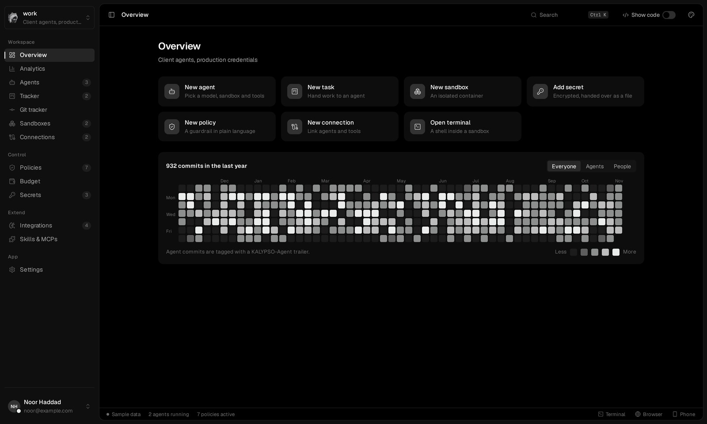
</picture>

## What it does

Every call an agent makes goes through four layers before it reaches a model or a tool.

| Layer | What it does |
|---|---|
| **Sandbox** | Each agent runs in a hardened container: read-only root, no Linux capabilities, its own network. Reaching a new domain can be made to need your approval. |
| **Policies** | Rules in plain words, such as "never force-push to main", checked before every tool call. Each one blocks, asks you, or warns. Risky calls wait for your answer. |
| **Vault** | Secrets are encrypted per namespace. Agents get a stand-in key, and the real one is added outside the sandbox. When an agent asks for a secret and you approve, only that one command gets it, and it is redacted from the output. |
| **Gateway** | Every model call is metered per agent and per model, and stops at the budget you set. Works with Anthropic, OpenAI-compatible APIs and Ollama. |

And around them:

- **Agents.** Agents built on the Claude Agent SDK, supervised and restarted if they crash.
- **Namespaces.** Separate networks, keys, budgets and policies for each workspace (personal, work, a client). Nothing crosses between them.
- **Connections.** Link agents to each other, to your tools (Obsidian, Notion, GitHub, any MCP server) or to other machines.
- **Observe.** A tracker board, a Git tracker that tells agent and human commits apart, and a monitoring view.
- **Tools.** Split terminals into sandboxes, a browser and a phone preview.
- **Code only when you ask.** Configs, specs and diffs stay folded until you open them.

## Screenshots

<table>
  <tr>
    <td width="50%">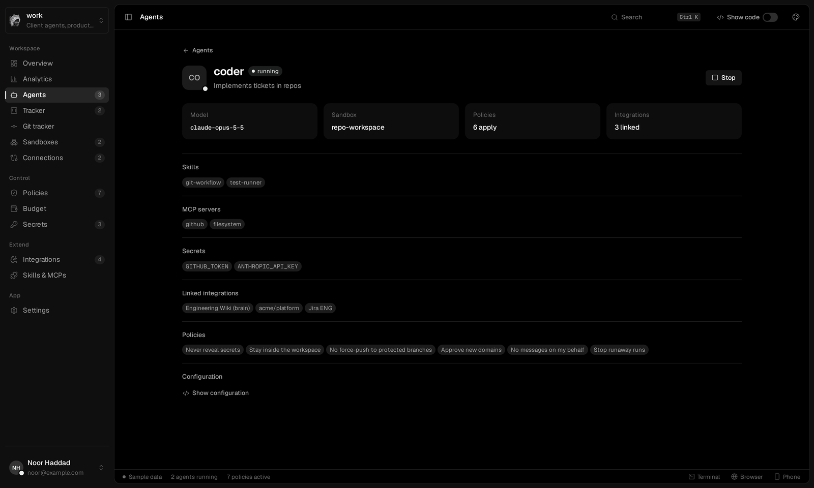</td>
    <td width="50%">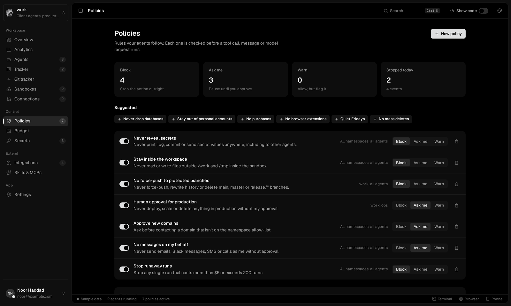</td>
  </tr>
  <tr>
    <td><b>Agents.</b> What each one runs, where, and what it may touch.</td>
    <td><b>Policies.</b> Block it, ask you first, or just flag it.</td>
  </tr>
  <tr>
    <td>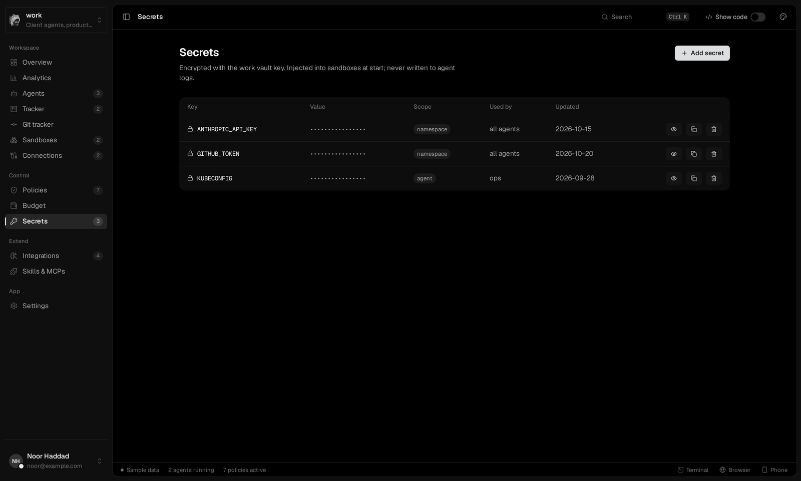</td>
    <td>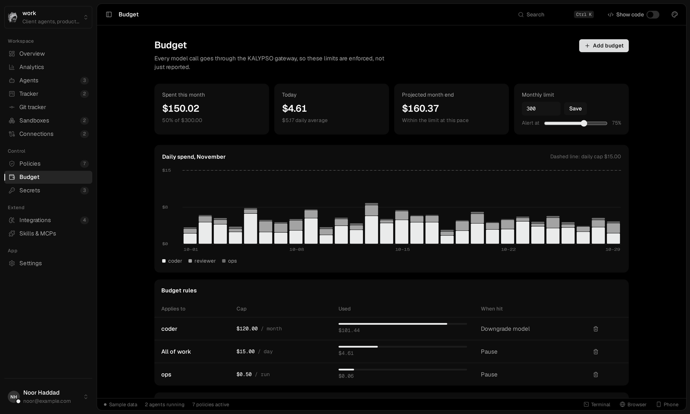</td>
  </tr>
  <tr>
    <td><b>Secrets.</b> Encrypted, scoped, never shown to an agent.</td>
    <td><b>Budget.</b> Spend per agent and model, with caps that pause or downgrade.</td>
  </tr>
</table>

**Tracker.** What each agent is working on, with time, cost and the pull request it opened. Drag a task to change its status; click it to open the details beside the board.

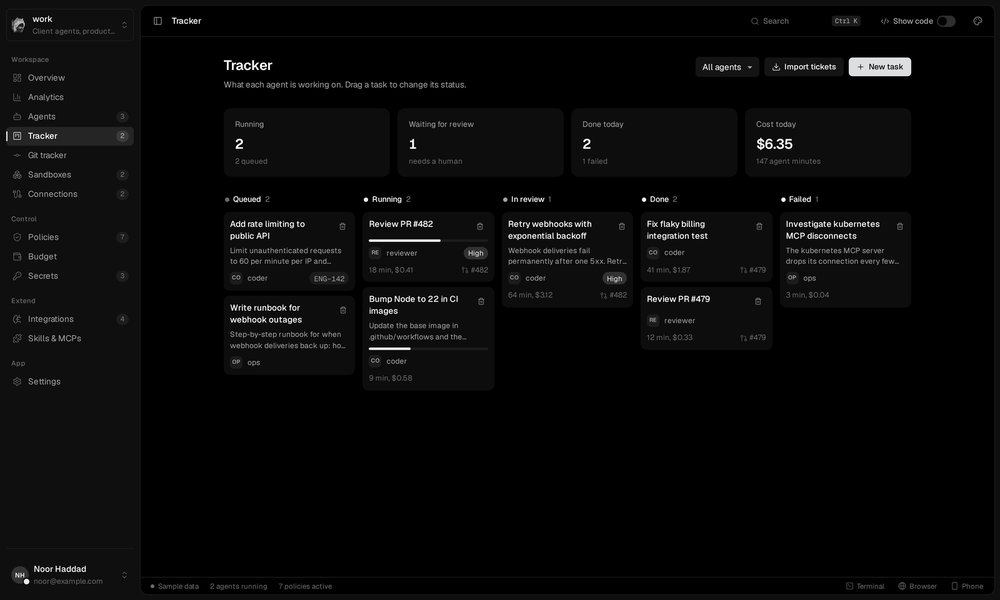

**Split terminals.** Shells into sandboxes, split right or down as many times as you like.

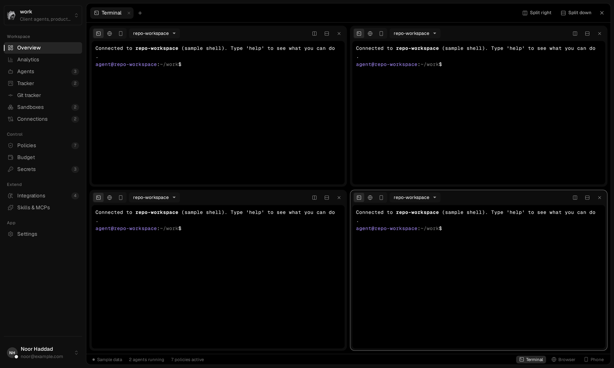

**Browser and phone preview.** A browser, and a phone-sized preview with common device sizes.

<table>
  <tr>
    <td width="50%">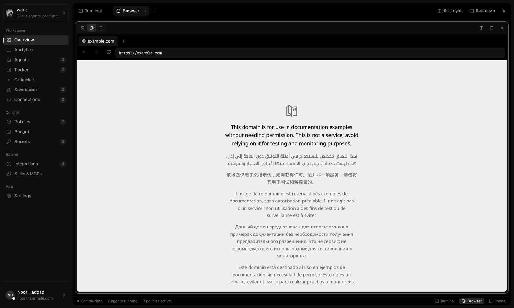</td>
    <td width="50%">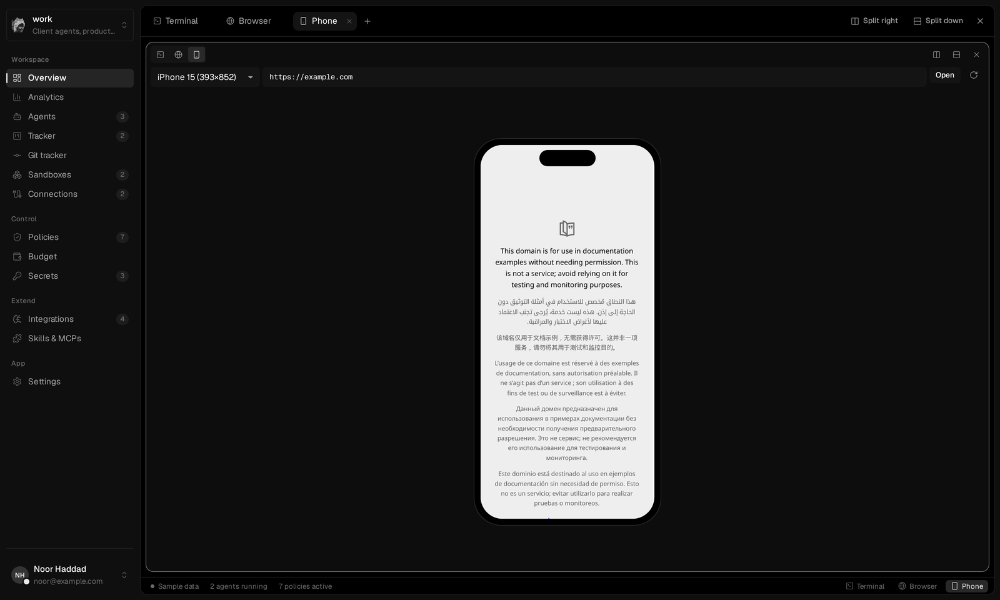</td>
  </tr>
</table>

**Themes.** Black, White and Blossom, or your own background, text and accent colours and font.

<table>
  <tr>
    <td></td>
    <td>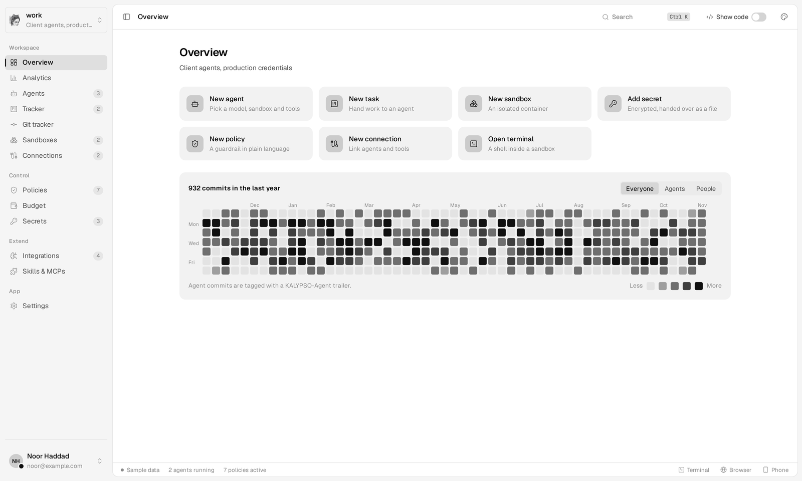</td>
    <td>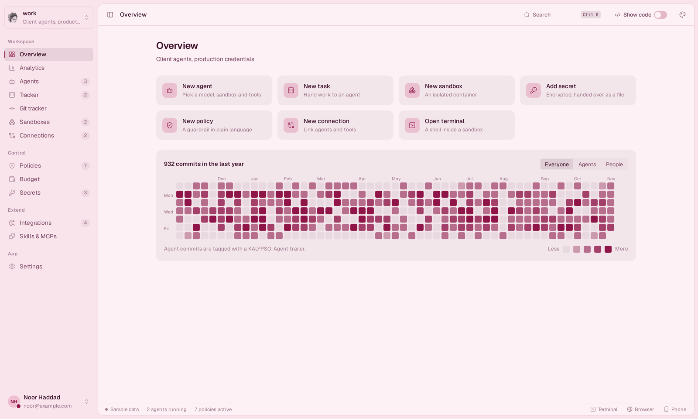</td>
  </tr>
  <tr>
    <td align="center">Black</td>
    <td align="center">White</td>
    <td align="center">Blossom</td>
  </tr>
</table>

The screenshots show the browser preview on sample data. The desktop app starts empty and shows only your own agents, sandboxes and secrets.

## Status

Pre-release (v0.1.x), working toward a public beta. In the desktop app today: namespaces, the encrypted vault and secret gateway, sandboxes on Docker or Podman with real shells, the agent supervisor with the Claude Agent SDK runtime, the policy engine with approvals, and the model gateway with budgets.

Next up for the beta: first-run setup, signed installers with auto-update, and agents linked to GitHub repositories. Progress is tracked in the [Roadmap](https://github.com/kalyppso/kalypso/issues/41).

## Download

Installers for Windows (`.exe`, `.msi`), macOS (`.dmg`) and Linux (`.deb`, `.rpm`, `.AppImage`) are on the [Releases](https://github.com/kalyppso/kalypso/releases) page and at [kalyppso.github.io/website](https://kalyppso.github.io/website/). Builds aren't code-signed yet, so Windows SmartScreen and macOS Gatekeeper will ask you to confirm the first launch.

## Run it

You need Node 20+, Rust stable and the [Tauri prerequisites](https://tauri.app/start/prerequisites/) for your OS. For sandboxes you also need Docker, or Podman with its API socket (`systemctl --user enable --now podman.socket`).

```bash
npm install
npm run tauri dev     # desktop app, backed by the Rust core
npm run dev           # UI only in a browser, on sample data
```

On WSL, if the window is blank, start it with `WEBKIT_DISABLE_DMABUF_RENDERER=1`.

## Develop

```bash
cd src-tauri
cargo test                          # unit and IPC tests
KALYPSO_TEST_RUNTIME=1 cargo test   # also run real container tests (needs Docker or Podman)
cargo clippy --all-targets -- -D warnings
npm run check:contrast              # WCAG contrast of the built-in themes
```

TypeScript types for the IPC layer are generated from the Rust structs into `src/bindings/` when the tests run. CI fails if they drift.

## Contributing

Commits and pull request titles follow [Conventional Commits](https://www.conventionalcommits.org): `type(scope): subject`.

```
feat(tracker): import tickets from Jira
fix(sandbox): detect Podman on Windows
docs(readme): add screenshots
```

Types: `feat`, `fix`, `docs`, `style`, `refactor`, `perf`, `test`, `build`, `ci`, `chore`, `revert`. Pull requests are squash-merged, so the PR title becomes the commit on `main`, and CI checks it.

## Layout

```
src/            React UI (views, components, store, generated bindings)
src-tauri/src/  Rust core: store, ns, vault, sandbox, agent, policy, gateway, budget, events, terminal, ipc
docs/           Architecture and images
```
