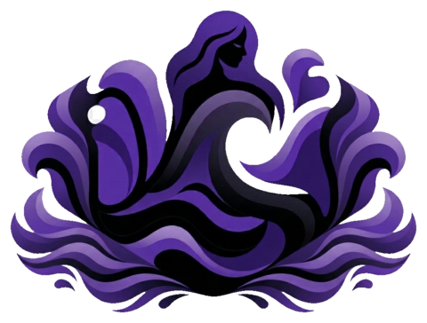
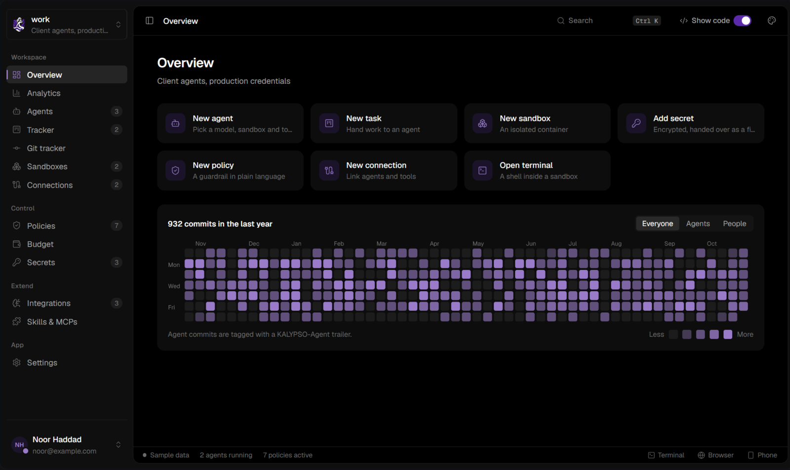
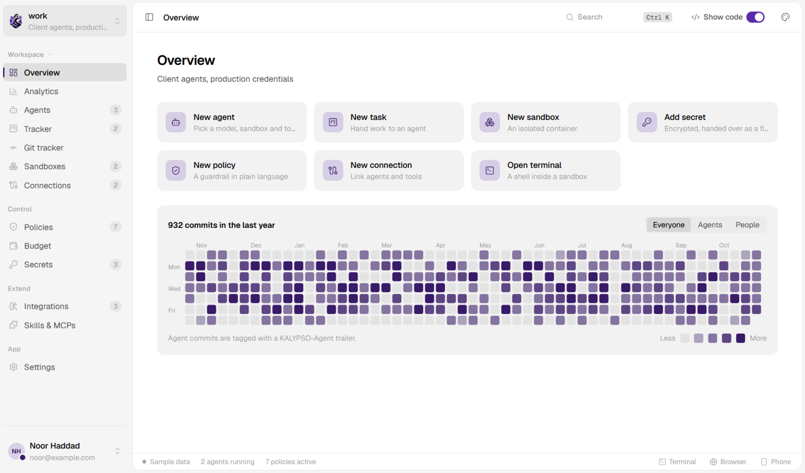
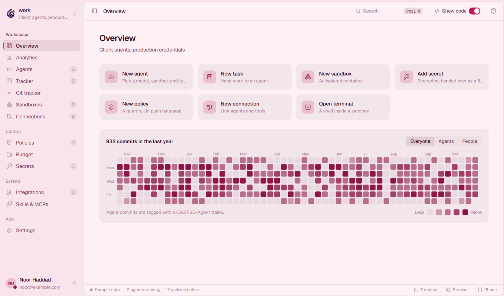
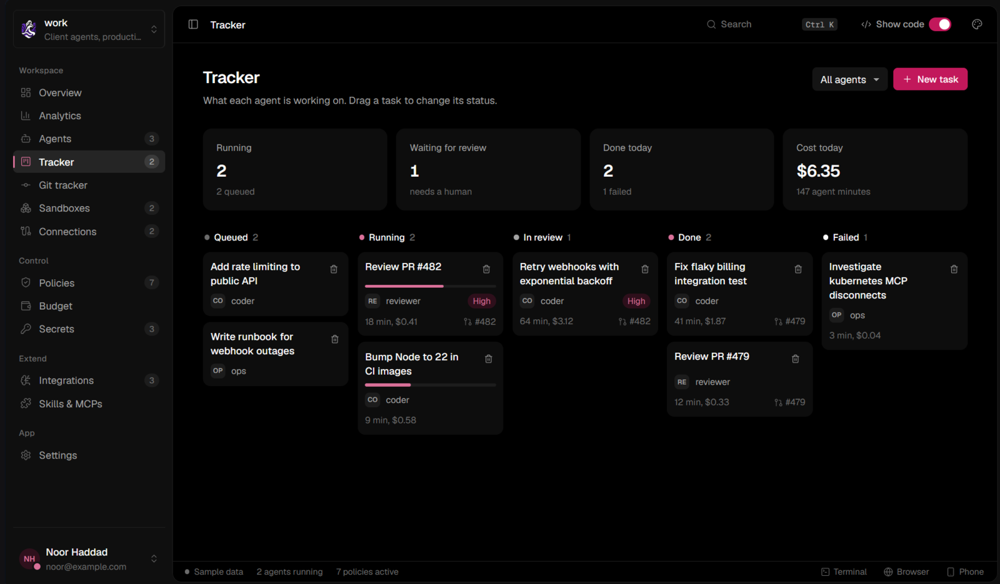
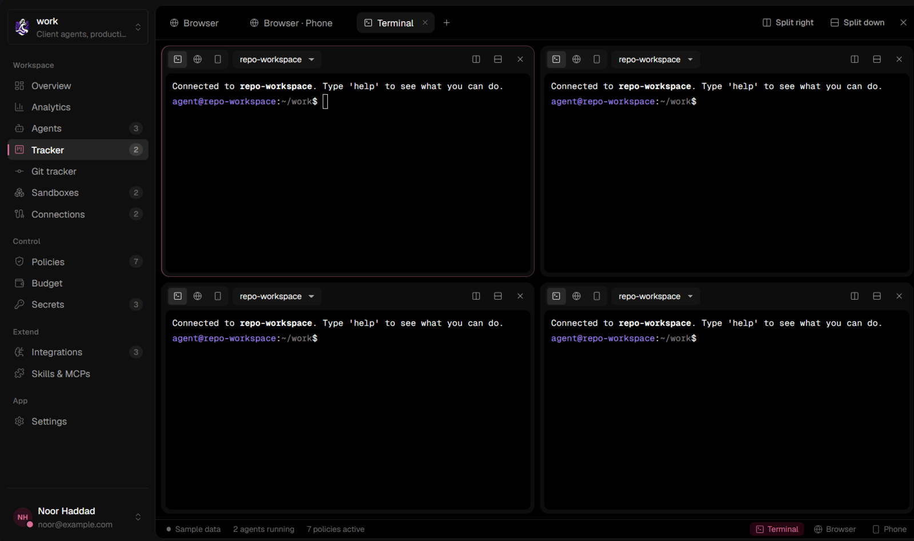
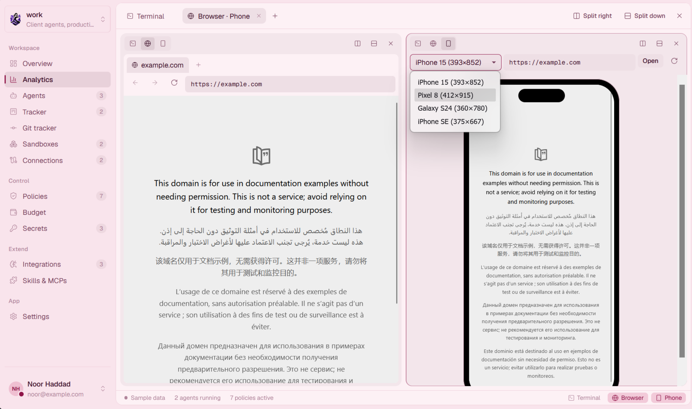

<p align="center">
  <picture>
    <source media="(prefers-color-scheme: dark)" srcset="docs/images/logo-dark.png">
    
  </picture>
</p>

<h1 align="center">KALYPSO</h1>

<p align="center">A desktop workspace for running and supervising AI agents.<br>Sandboxes, secrets, budgets, policies and connections, kept apart by namespaces.</p>

<p align="center">
  <a href="https://github.com/kalyppso/kalypso/actions/workflows/ci.yml"></a>
  <a href="https://github.com/kalyppso/kalypso/issues/41">Roadmap</a> ·
  <a href="docs/ARCHITECTURE.md">Architecture</a>
</p>

<picture>
  <source media="(prefers-color-scheme: light)" srcset="docs/images/overview-light.png">
  
</picture>

## What it does

- **Sandboxes.** Every agent runs in a hardened container: read-only root, no Linux capabilities, its own network.
- **Namespaces.** Separate networks, encryption keys, budgets and policies for each workspace (personal, work, a client). Nothing crosses between them.
- **Secrets.** Encrypted at rest with a per-namespace key and handed to agents as files, never in prompts. Every reveal is logged.
- **Policies.** Plain-language guardrails such as "never force-push to main", each set to block, ask you, or warn.
- **Budgets.** Monthly, daily and per-run caps that pause an agent, alert you, or switch it to a cheaper model.
- **Connections.** Link agents to each other, to your tools (Obsidian, Notion, GitHub, any MCP server) or to other machines.
- **Observe.** A tracker board, a Git tracker with agent and human commits told apart, and live monitoring.
- **Tools.** Split terminals into sandboxes, a browser and a phone preview.
- **Code only when you ask.** Configs, specs and diffs stay folded until you open them.

## Screenshots

**Themes.** Black, White and Blossom, or your own background, text and accent colours and font.

<table>
  <tr>
    <td></td>
    <td></td>
    <td></td>
  </tr>
  <tr>
    <td align="center">Black</td>
    <td align="center">White</td>
    <td align="center">Blossom</td>
  </tr>
</table>

**Tracker.** What each agent is working on, with time, cost and the pull request it opened. Drag a task to change its status; click it to open the details beside the board.



**Split terminals.** Shells into sandboxes, split right or down as many times as you like.



**Browser and phone preview.** A browser and a phone-sized preview side by side, with common device sizes.



## Status

Early. The whole UI exists as a prototype on sample data. The Rust core (Phase 1) is being built, and namespaces, secrets and sandboxes already run for real in the desktop app. Progress is tracked in the [Roadmap](https://github.com/kalyppso/kalypso/issues/41).

## Download

Installers for Windows (`.exe`, `.msi`), macOS (`.dmg`) and Linux (`.deb`, `.rpm`, `.AppImage`) are on the [Releases](https://github.com/kalyppso/kalypso/releases) page and at [kalyppso.github.io/website](https://kalyppso.github.io/website/). Builds aren't code-signed yet, so Windows SmartScreen and macOS Gatekeeper will ask you to confirm the first launch.

## Run it

You need Node 20+, Rust stable and the [Tauri prerequisites](https://tauri.app/start/prerequisites/) for your OS. For sandboxes you also need Docker, or Podman with its API socket (`systemctl --user enable --now podman.socket`).

```bash
npm install
npm run tauri dev     # desktop app, backed by the Rust core
npm run dev           # UI only in a browser, on sample data
```

On WSL, if the window is blank, start it with `WEBKIT_DISABLE_DMABUF_RENDERER=1`.

## Develop

```bash
cd src-tauri
cargo test                          # unit and IPC tests
KALYPSO_TEST_RUNTIME=1 cargo test   # also run real container tests (needs Docker or Podman)
cargo clippy --all-targets -- -D warnings
```

TypeScript types for the IPC layer are generated from the Rust structs into `src/bindings/` when the tests run. CI fails if they drift.

## Contributing

Commits and pull request titles follow [Conventional Commits](https://www.conventionalcommits.org): `type(scope): subject`.

```
feat(tracker): import tickets from Jira
fix(sandbox): detect Podman on Windows
docs(readme): add screenshots
```

Types: `feat`, `fix`, `docs`, `style`, `refactor`, `perf`, `test`, `build`, `ci`, `chore`, `revert`. Pull requests are squash-merged, so the PR title becomes the commit on `main`, and CI checks it.

## Layout

```
src/            React UI (views, components, store, generated bindings)
src-tauri/src/  Rust core: store, ns, vault, sandbox, events, ipc
docs/           Architecture and images
```
